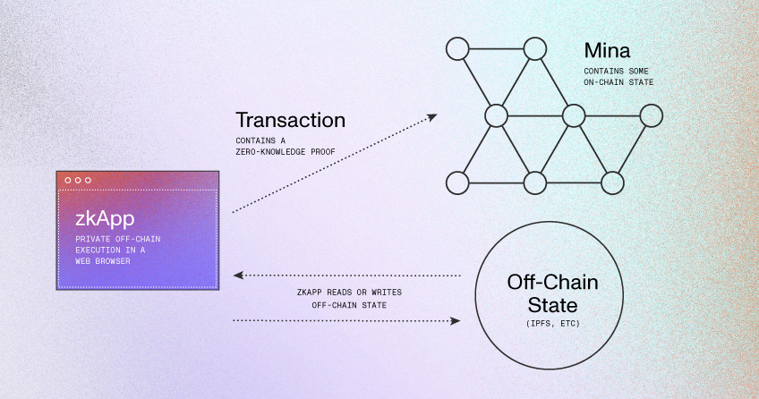

# Smart Contracts

## What are Smart Contracts?

A **smart contract** is a self-executing digital agreement written in code and stored on a blockchain. They automate and enforce contract terms without requiring intermediaries. Smart contracts leverage blockchain technology for increased **security** and **transparency**, streamlining processes and transactions across various industries.

> [!TIP] 💡 Smart Contracts 💡
> They can be thought of as a virtual "if-then" statement; for example, _if_ a buyer sends the agreed-upon amount, _then_ the smart contract automatically executes and transfers ownership of an asset from seller to buyer. This allows two parties to transact directly without needing a third party to ensure the agreement is honoured.

Beyond simple transactions, smart contracts enable a wide array of use cases, including:

- **Financial transactions**: Automated and secure transfers, payments, and complex financial agreements.
- **Decentralized applications (DApps)**: Serving as the backbone for platforms like Decentralized Finance (DeFi) protocols (lending, borrowing, trading) and gaming platforms with in-game assets.
- **Non-fungible tokens (NFTs)**: Platforms for creation, ownership, and trading of unique digital assets.
- **Insurance**: Automating claims processing and payouts based on predefined conditions.
- **Supply chain management**: Tracking goods, ensuring transparency, and automating processes like order fulfilment and payment.
- **Intellectual property**: Managing ownership, distribution, and automating royalty payments.
- **Voting systems**: Facilitating secure, transparent, and fraud-preventing voting.

## How Do Smart Contracts Work?

The operation of smart contracts relies on **blockchain technology**, code execution, and decentralized consensus. Here's a simplified process:

1. **Creation and Deployment**: A developer writes the smart contract code using a language compatible with the blockchain and deploys it onto the network.
2. **Code and Conditions**: The contract contains code defining the terms, rules, and conditions of the agreement, which can range from simple payments to complex multi-step processes.
3. **Contract Invocation**: Once deployed, anyone with access to the blockchain can interact with the smart contract by calling its functions and providing necessary inputs. This is common when users interact with DeFi services and DApps via crypto wallets.
4. **Validation and Execution**: When invoked, the transaction is verified and validated by each node in the blockchain network, which guarantees secure execution. If the specified conditions are met, the task defined by the contract code is automatically executed.
5. **Immutable Record**: Upon validation and confirmation, the execution is recorded as an immutable entry on the blockchain ledger, making it transparent and auditable.
6. **Finality**: The execution of a smart contract is final and cannot be reversed, ensuring the transaction's integrity and security.

::: warning
While offering many advantages like transparency, security, and efficiency, smart contracts also have potential drawbacks, including security vulnerabilities from code errors, and scalability limitations on the underlying blockchain network.
These challenges are addressed with bug bounty programs, security audits, standardisation efforts, and **Layer-2 solutions** such as rollups.
:::

## Smart Contracts on Mina and Zeko : zkApps

On Mina Protocol, smart contracts are called **zkApps** (zero-knowledge applications). These leverage **zero-knowledge proofs** (ZKPs) to verify state transitions, allowing transactions to be proved off-chain and verified on-chain without revealing private data.

> [!TIP] 💡 zkApps Validation and Execution 💡
> zkApps are validated client-side, which means that the network throughput is higher than other blockchains that have to validate smart contracts at the node level.

ZKPs in zkApps are primarily used for two purposes: to hide parts of the data and to **compress the computation**. The transaction snark uses the compression property to validate a batch of transactions into the verification of a single snark. While the "zk" part can hide data, this is often a side product; the main goal in zkApps is **proving that you've executed the smart contract correctly** off-chain.

**Zeko is a Layer 2 (L2) ecosystem specifically designed for Mina's zkApps**. It aims to provide a robust platform for building and deploying zkApps with improved throughput and quick confirmation times.

> [!TIP] 💡 More about zkApps 💡
> For more information on zkApps, refer to the [Mina documentation](https://docs.minaprotocol.com/zkapps/writing-a-zkapp).
