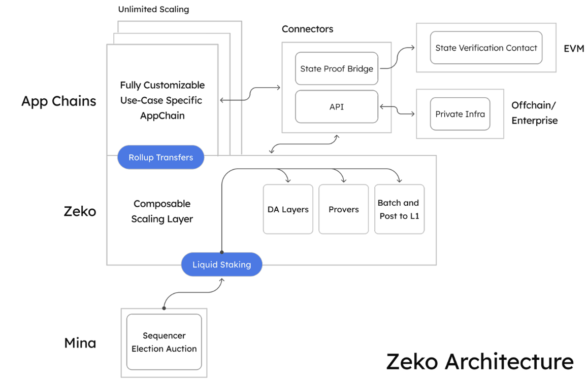

# What is Zeko?

_Zeko is a zk-rollup protocol built on Mina, designed for scalable, private, and secure blockchain applications._

## High-Level Summary

[Zeko](https://zeko.io/) is a cross-chain, zero-knowledge scaling protocol built on Mina that enables developers to launch fast, private, and scalable decentralized applications. It combines the privacy guarantees of zero-knowledge proofs with the efficiency of off-chain computation and the security of Mina’s succinct L1, creating a modular, universal operating system for the new internet.

Zeko testnet launch represents a preview of Zeko Protocol capabilities and functionalities to come. While this version will continue to evolve over time, it provides a foundation for developers to start building and assess how to deploy more scalable, feature-rich applications on Zeko. With the release of our protocol, developers gain access to all the existing tooling and features built for Mina, plus many unique to Zeko designed to simplify the zero-knowledge development process. From proof generation, recursion, smart contract creation to decentralized storage solutions, our platform offers everything developers need to realize the potential to bring your dApp ideas to life.

The Zeko team and community are passionate about decentralization and user-owned data, and their combined potential to revolutionize industries across the globe. Zeko is all about amplifying your potential as a developer; and with our launch you now have the opportunity to dive into the protocol, explore its features, and unlock the magic of zero-knowledge technology.

## Purpose of Zeko

Zeko builds upon the most decentralised ZK settlement layer, Mina, to provide a platform for fast, cheap and versatile zkApps. Zeko places zero-knowledge proof (ZKP) capabilities into the hands of developers, massively expanding the design space for blockchain applications as we know them today. ZKPs are no longer theoretical, and now through Zeko, application developers are empowered to innovate and explore new types of decentralized applications bridging Web2 and Web3 whilst optimizing performance and user experience. Moreover, through the upcoming release of the Aligned Layer bridge and future bridges, proofs that verify on Zeko can be consumed by the EVM, dramatically upending existing paradigms for blockchain applications.

Zeko allows developers to create zkRollups specifically designed for zero-knowledge applications (zkApps) that support both end user privacy and recursive proof aggregation. zkApps on Zeko are written in Typescript using o1js, an efficient and extensible zkDSL. Developers can recursively prove unlimited off-chain computation whilst also maintaining privacy over user data.

Developers can write and deploy applications today to a Zeko L2 that is isomorphic to the Mina L1, or spin up their own custom zkAppChains. What makes Zeko so powerful is it’s built using o1js programming language built by the o1Labs team, which means Zeko chains will enjoy easy composability between each other and Mina itself using recursive proofs.
