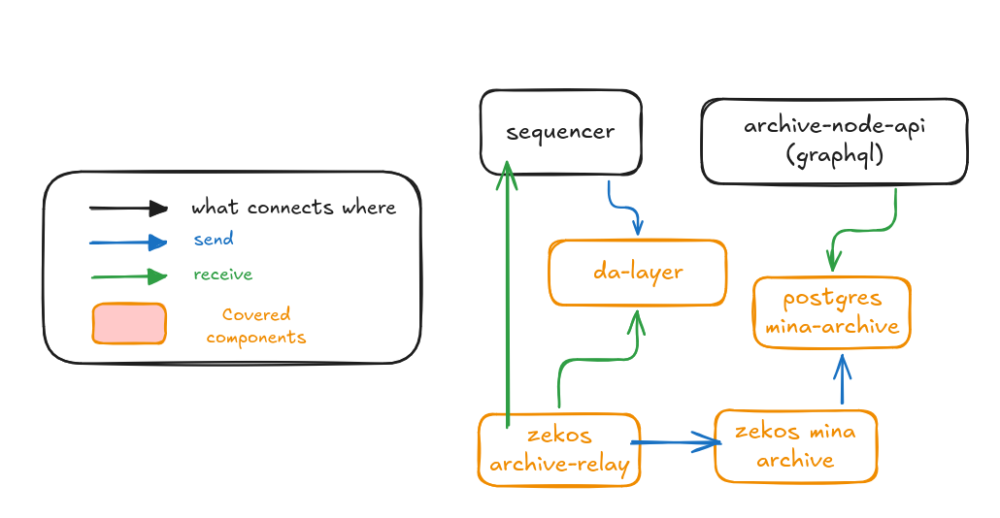

# Running Zeko's DA Node

A critical component of any rollup system is the data availability layer. This layer is responsible for storing all the transaction data that occurs on the rollup.

In this guide we will create a `da-layer` node that receives transaction data from the Zeko L2 rollup.

Not covered in this guide:

- Running the archive stack used to query historical data. See [Running Zeko's Archive Node](./archive-node.md).
- Exposing your `da-layer` to the internet

We will use [docker compose](https://docs.docker.com/reference/cli/docker/compose/) to define the whole stack in a single file.

TL;DR skip to the [Bootstrap process](#bootstrap-process)

## Prerequisites

### System Requirements

- Linux or macOS (Windows WSL2 works too)
- **1 CPU core**, **2GB RAM**

### Installed Software

- `Docker`

## Overview



In the diagram above you see:

- Zeko's sequencer sending transactions to `da-layer`
- the optional archive stack that can index and serve historical data from your DA node

### Project Structure

Layout of the project directory:

```
project-root/
└── docker-compose.yaml
```

> **Note:** `docker-compose.yaml` is using docker volumes to store data. If you prefer to mount local directories instead - change accordingly.

### Wallets

To run a da-layer you will need:

- `da-signer` - Holds the wallet credentials that is used by `da-layer`.
- `da-layer` - Each `da-layer` node is started with its wallet.

### Volumes/files

| Volumes         | Files                         | Purpose                                       |
| --------------- | ----------------------------- | --------------------------------------------- |
| `keys_data`     | `da-layer-sk`                 | Private key of the DA node                    |
| `keys_data`     | `da-layer-pk`                 | Public key of the DA node (used by sequencer) |
| `keys_data`     | `da-signer/signer-auth-token` | Auth token shared by DA layer and signer      |
| `keys_data`     | `da-signer/signer-tls.crt`    | TLS certificate for DA layer signer           |
| `keys_data`     | `da-signer/signer-tls.key`    | TLS private key for DA layer signer           |
| `da-layer_data` |                               | Persistent storage for da-layer               |

### Service Overview

- `init-config`
- `da-signer`
- `da-layer`

### Ports Exposed

| Service   | Port   | Description      |
| --------- | ------ | ---------------- |
| da-layer  | `1924` | da-layer rpc API |
| da-signer | `9001` | da-layer signer  |

---

## Bootstrap process

### Getting/Creating configuration files

- Copy `docker-compose.yaml` to your project folder.
  ::: details Click to expand `docker-compose.yaml`
  ```yaml
  services:
    init-config:
      image: docker.io/zekolabs/zeko:latest
      container_name: init-config
      working_dir: /data
      volumes:
        - keys_data:/data/keys
      entrypoint:
        - sh
        - -c
      restart: "no"
      command: >
        "while [ ! -f /data/keys/.keys_created ];
          do sleep 2;
        done; exit 0"
    da-signer:
      depends_on:
        init-config:
          condition: service_completed_successfully
      image: docker.io/zekolabs/zeko-da:latest
      container_name: da-signer
      ports:
        - "9001:9001"
      entrypoint: bash -c
      command: |
        "export MINA_PRIVATE_KEY=$(cat /keys/da-layer-sk) && \\
        export ZEKO_SIGNER_AUTH_TOKEN=$(cat /keys/da-signer/signer-auth-token) && \\
        exec zeko-signer \\
        run \\
        --port 9001 \\
        --allow-field-signing \\
        --tls-cert-file /keys/da-signer/signer-tls.crt \\
        --tls-key-file /keys/da-signer/signer-tls.key"
      volumes:
        - keys_data:/keys:ro
      restart: always
    da-layer:
      depends_on:
        da-signer:
          condition: service_started
      image: docker.io/zekolabs/zeko-da:latest
      container_name: da-layer
      ports:
        - "1924:1924"
      environment:
        ZEKO_SIGNATURE_KIND: "testnet"
      entrypoint: bash -c
      command: |
        "export ZEKO_SIGNER_AUTH_TOKEN=$(cat /keys/da-signer/signer-auth-token) && \\
        export ZEKO_SIGNER_TLS_CA_FILE=/keys/da-signer/signer-tls.crt && \\
        exec zeko-da \\
        run-node \\
        --port 1924 \\
        --db-dir /data/db \\
        --signer da-signer:9001 \\
        --network-id testnet"
      volumes:
        - da-layer_data:/data
        - keys_data:/keys:ro
      restart: always

  volumes:
    da-layer_data:
    keys_data:
  ```

- Start all services
  ```bash
  docker compose up -d
  ```
- Create `da-layer` keys
  1. Enter `init-config` container:
  ```bash
  docker compose exec -it init-config bash
  ```
  > **Note:** This image contains `zeko-cli` binary.

  2. Create `da-layer` keypair
  > - `/data/keys/da-layer-pk`
  > - `/data/keys/da-layer-sk`
  > - `/data/keys/da-signer/signer-auth-token`
  > - `/data/keys/da-signer/signer-tls.crt`
  > - `/data/keys/da-signer/signer-tls.key`

  `da-signer/signer-auth-token` is the random token shared by `da-layer` and `da-signer`. `da-signer/signer-tls.crt` and `da-signer/signer-tls.key` are the self-signed TLS files used by `da-signer`.

  The certificate Subject Alternative Name must match the signer host used by `--signer`. This Docker Compose file uses `da-signer`, so the SAN is `DNS:da-signer`.

  > **Note:** Take note of `da-layer-pk`

  ```bash
  # create `da-layer` keypair
  zeko-cli generate-even-key | while read label1 label2 value; do
  if [ "$label1" = "Private" ]; then
    echo "$value" > da-layer-sk
  elif [ "$label1" = "Public" ]; then
    echo "$value" > da-layer-pk
  fi
  done

  mv da-layer-{sk,pk} /data/keys

  # create `da-signer` auth token and TLS files
  install -d -m 0700 /data/keys/da-signer
  openssl rand -hex 32 > /data/keys/da-signer/signer-auth-token
  chmod 0600 /data/keys/da-signer/signer-auth-token

  DA_SIGNER_HOST=da-signer
  DA_SIGNER_SAN=DNS:$DA_SIGNER_HOST
  openssl req -x509 -newkey rsa:4096 -sha256 -days 3650 -nodes \
    -keyout /data/keys/da-signer/signer-tls.key \
    -out /data/keys/da-signer/signer-tls.crt \
    -subj "/CN=$DA_SIGNER_HOST" \
    -addext "subjectAltName=$DA_SIGNER_SAN"
  chmod 0644 /data/keys/da-signer/signer-tls.crt
  chmod 0600 /data/keys/da-signer/signer-tls.key

  touch /data/keys/.keys_created
  ```

### If all the steps were performed correctly you have the following:

- `da-layer` getting data from Zeko's L2

### Let Zeko know about your DA Layer

In order for you to start receiving transactions from Zeko L2 sequencer you need to:

- Expose your da-layer on the internet
- Contact Zeko and ask to be added to DA node list. You will need to provide:
  - your `da-layer` public key
  - address:port on which Zeko's sequencer can reach your `da-layer`

### Synchronizing the data

Once your DA node will be added to Zeko's Sequencer, your node will start receiving transactions. Synchronizing might take some time. It depends when did the sequencer receive a hard reset.

If you want to index that data and query it through an archive API, continue with [Running Zeko's Archive Node](./archive-node.md).
