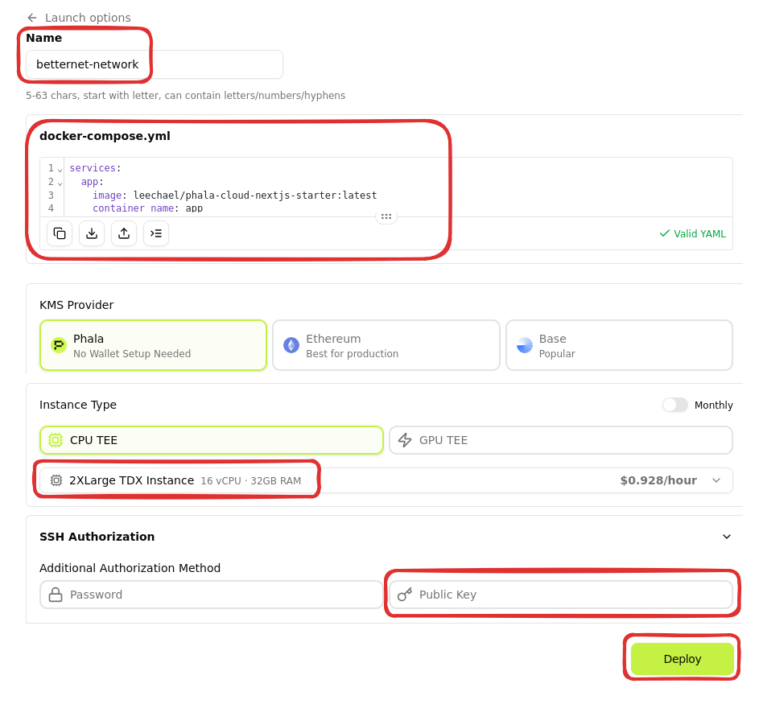
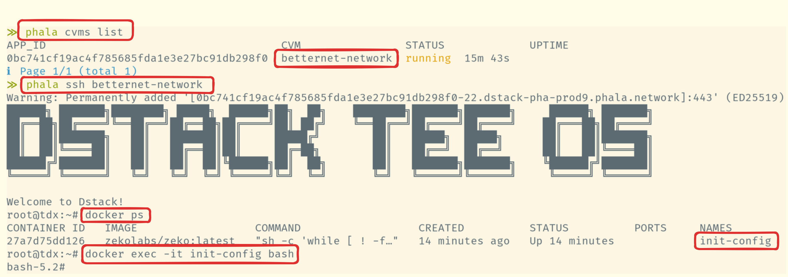

# Launch a rollup on Phala

In this guide we will cover how to launch your rollup on [Phala](https://docs.phala.com/phala-cloud).

## Prerequisites

You will need:

- [Phala account](https://docs.phala.com/phala-cloud/getting-started/sign-up-for-cloud-account)
- [Phala cli tool](https://docs.phala.com/phala-cloud/phala-cloud-cli/overview#cli-overview)

## Overview

We are going to:

- Create a phala CVM
- Create a rollup on deployed CVM

## Bootstrap process

### Create a CVM

On your accounts dashboard click `Deploy`.

- Paste docker-compose.yaml contents from the [Launch a Rollup](./launch-rollup.md) guide
- Select 32G instance
- Add your public ssh key to be able later to connect to your CVM
- Deploy!



> **Note:** To deploy a rollup we need at least 24G of RAM, therefore we have to select 32G instance (this can be redeployed on a 16G later).

### SSH to your CVM

- From your terminal login to your Phala cloud

```bash
phala login
```

- Get a list of CVMs
- SSH to a wanted CVM
- You should be able to exec into `init-config` container



### Bootstrap a rollup

With a working docker setup now you can follow our [Launch a Rollup](./launch-rollup.md) guide.
