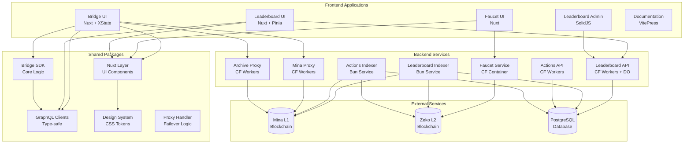
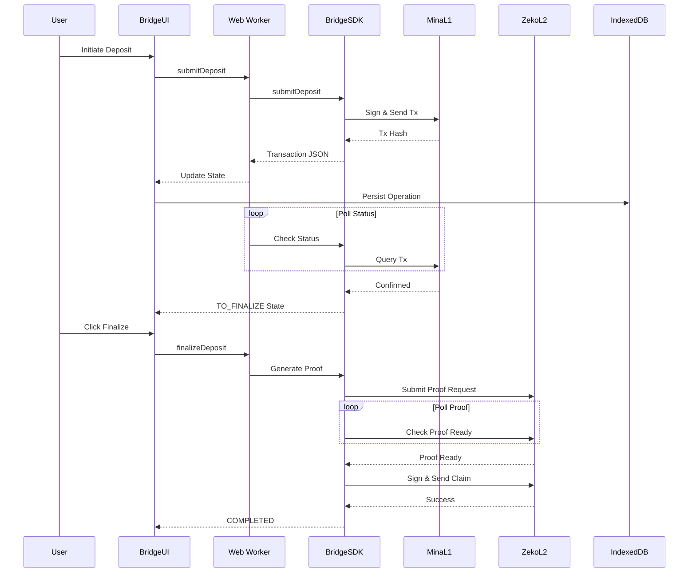
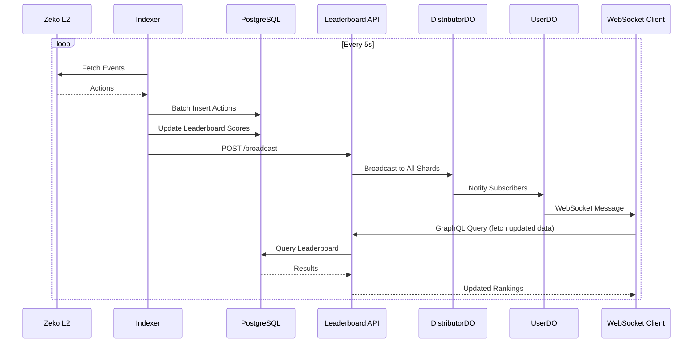
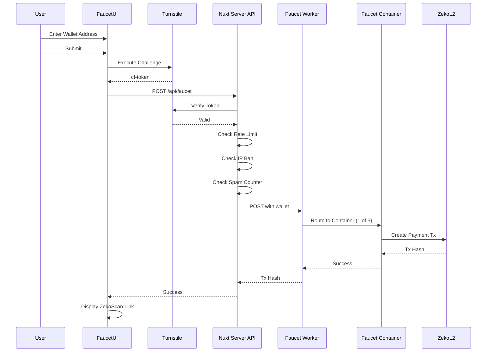

# Zeko UI Codebase Map

> Auto-generated by Cartographer. Last mapped: 2026-01-29

## System Overview



## Directory Structure

```
zeko-ui/
├── apps/                      # User-facing applications
│   ├── bridge-ui/            # Cross-chain bridge interface (Nuxt, XState, Cloudflare)
│   ├── docs/                 # VitePress documentation site
│   ├── faucet/               # Testnet token faucet service (Cloudflare Container)
│   ├── faucet-ui/            # Faucet web interface (Nuxt)
│   ├── leaderboard-admin/    # Admin panel for leaderboard (SolidJS)
│   └── leaderboard-ui/       # Public leaderboard interface (Nuxt + real-time)
│
├── packages/                  # Shared libraries
│   ├── bridge-sdk/           # Core bridge protocol implementation
│   ├── design/               # Design tokens and theme (cssforge)
│   ├── graphql/              # Type-safe GraphQL clients (gql.tada)
│   ├── layer/                # Shared Nuxt layer with components
│   └── proxy-handler/        # Generic proxy with failover
│
├── services/                  # Backend infrastructure
│   ├── actions/              # Bridge actions tracking
│   │   ├── api/             # GraphQL API (Cloudflare Workers)
│   │   └── indexer/         # Blockchain indexer (Bun)
│   ├── leaderboard/          # Contest leaderboard system
│   │   ├── api/             # GraphQL API + WebSocket (CF Workers + DO)
│   │   └── indexer/         # Event indexer (Bun)
│   ├── mina-archive-proxy/   # Mina archive proxy
│   ├── mina-proxy/           # Mina node proxy
│   └── proxies/              # Additional proxy services
│
├── .github/                   # CI/CD workflows (GitHub Actions)
├── .moon/                     # Moon task runner configuration
├── northflank/               # Northflank deployment configs
├── fly/                      # Fly.io deployment configs
├── patches/                  # pnpm patches for dependencies
└── spec/                     # Technical specifications
```

## Module Guide

### Frontend Applications

#### apps/bridge-ui/ (~52k tokens)

**Purpose**: Full-featured cross-chain bridge for transferring assets between Mina L1 and Zeko L2

**Entry point**: `app/pages/index.vue`

**Key files**:

| File                              | Purpose                                                  | Tokens |
| --------------------------------- | -------------------------------------------------------- | ------ |
| machines/bridge.ts                | Parent state machine orchestrating all bridge operations | ~437   |
| machines/bridgeOperation.ts       | Individual deposit/withdrawal operation state machine    | ~799   |
| machines/operations.worker.ts     | Web Worker for heavy blockchain operations               | ~221   |
| machines/transaction.ts           | Generic transaction signing and confirmation machine     | ~274   |
| app/composables/useBridgeStore.ts | Pinia store connecting machines to Vue                   | ~42    |

**Stack**: Nuxt 3, XState 5 (state machines), Web Workers, IndexedDB, Lumina DEX SDK

**Exports**: N/A (application)

**Dependencies**:

- Internal: `@zeko-labs/bridge-sdk`, `@zeko/layer`, `@zeko-labs/graphql`
- External: `@lumina-dex/sdk`, `xstate`, `o1js`, Auro wallet

**Patterns**:

- Actor model with parent-child state machines
- Web Worker offloading for cryptographic operations
- Operation persistence via IndexedDB
- Hierarchical state management (deposits/withdrawals with substates)
- Network-aware state transitions

**Gotchas**:

- Only one active operation at a time; others auto-pause
- Mainnet detection redirects to testnet (not production-ready)
- Deposits can timeout and require cancellation to recover funds
- Desktop-only in production (mobile blocked by middleware)

---

#### apps/docs/ (~122k tokens)

**Purpose**: VitePress documentation site covering Zeko protocol, architecture, and guides

**Entry point**: `.vitepress/config.ts`

**Key files**:

| File                 | Purpose                                                     | Tokens |
| -------------------- | ----------------------------------------------------------- | ------ |
| .vitepress/config.ts | VitePress configuration and navigation                      | ~300   |
| content/             | Markdown documentation (introduction, architecture, guides) | ~121k  |
| worker.ts            | Cloudflare Workers handler                                  | ~10    |

**Stack**: VitePress, Cloudflare Workers, D2 diagrams

**Exports**: N/A (application)

**Dependencies**:

- `vitepress`, `vitepress-plugin-d2`, `vitepress-plugin-llms`

**Patterns**: Static site generation with markdown enhancement

**Gotchas**: Content directory is `content/` not default `docs/`

---

#### apps/faucet/ (~9.8k tokens)

**Purpose**: Backend service for distributing testnet tokens via Cloudflare Containers

**Entry point**: `worker.ts` (orchestrator), `src/index.ts` (container)

**Key files**:

| File          | Purpose                                         | Tokens |
| ------------- | ----------------------------------------------- | ------ |
| worker.ts     | Worker entry point with container orchestration | ~82    |
| src/faucet.ts | Core payment transaction logic using o1js       | ~85    |
| src/index.ts  | Hono server in container                        | ~37    |

**Stack**: Cloudflare Workers + Containers, Hono, o1js, Bun runtime

**Exports**: N/A (service)

**Dependencies**: `o1js`, `@cloudflare/containers`

**Patterns**:

- Container compute isolation (3 instances)
- Fee escalation on retry
- KV-based claim tracking

**Gotchas**:

- Uses o1js internals for Poseidon hashing
- Container selection is random (TODO: latency-aware routing)
- 502 errors specifically detected and rewritten to 503

---

#### apps/faucet-ui/ (~7.7k tokens)

**Purpose**: Web interface for requesting testnet tokens with bot protection

**Entry point**: `app/pages/index.vue`

**Key files**:

| File                            | Purpose                               | Tokens |
| ------------------------------- | ------------------------------------- | ------ |
| app/pages/index.vue             | Main faucet form with Turnstile       | ~403   |
| app/composables/useTurnstile.ts | Cloudflare Turnstile integration      | ~98    |
| server/api/faucet.post.ts       | Backend API with multi-layer security | ~110   |

**Stack**: Nuxt 3, XState, Arktype validation, Cloudflare Turnstile

**Exports**: N/A (application)

**Dependencies**:

- Internal: `@zeko/layer`
- External: Cloudflare Turnstile, faucet service

**Patterns**:

- XState for form state
- Multiple security layers (Turnstile, rate limit, IP ban, spam detection)
- KV for distributed state

**Gotchas**:

- Turnstile executes invisibly on submit
- Spam threshold/window configurable via env
- Auto-ban on spam threshold (24h default TTL)

---

#### apps/leaderboard-ui/ (~56k tokens)

**Purpose**: Real-time contest leaderboard with GraphQL subscriptions and animated UI

**Entry point**: `app/pages/index.vue`

**Key files**:

| File                                | Purpose                                       | Tokens |
| ----------------------------------- | --------------------------------------------- | ------ |
| app/composables/useLeaderboard.ts   | Pinia store with pagination and subscriptions | ~200   |
| app/plugins/urql.ts                 | URQL GraphQL client with SSE subscriptions    | ~50    |
| app/components/LeaderboardTable.vue | Main table with search and pagination         | ~150   |
| app/components/Header.vue           | Animated header with rotating rings           | ~100   |

**Stack**: Nuxt 3, Pinia, URQL (SSE subscriptions), Ark UI, NumberFlow animations

**Exports**: N/A (application)

**Dependencies**:

- Internal: `@zeko-labs/graphql`, `@zeko/layer`
- External: `@urql/vue`, `@tanstack/vue-table`, `@ark-ui/vue`, `@number-flow/vue`

**Patterns**:

- SSE for GraphQL subscriptions (not WebSocket)
- Pinia composition API store
- Aggressive retry logic (5 attempts)
- Static prerendering with SSR disabled

**Gotchas**:

- Subscription auto-reconnects on completion/error
- Search only activates when wallet address is exactly 55 characters
- Hardcoded stats in contest popup (not from API)

---

#### apps/leaderboard-admin/ (~6.9k tokens)

**Purpose**: Admin panel for controlling leaderboard indexer

**Entry point**: `src/index.tsx`

**Key files**:

| File                      | Purpose                                | Tokens |
| ------------------------- | -------------------------------------- | ------ |
| src/App.tsx               | Main UI with indexer control           | ~300   |
| src/api.ts                | ElysiaJS Eden client for type-safe API | ~80    |
| src/ManualAdjustments.tsx | JSON-based manual point adjustments    | ~150   |

**Stack**: SolidJS, Valibot validation, Elysia Eden Treaty, Pico CSS

**Exports**: N/A (application)

**Dependencies**: `solid-js`, `@elysiajs/eden`, `valibot`, `@picocss/pico`

**Patterns**:

- SolidJS signals and resources
- End-to-end type safety via Eden Treaty
- Valibot schema validation

**Gotchas**:

- Token stored in localStorage (not secure)
- Status refreshes every 5s only when tab visible
- Operations don't show loading spinners

---

### Shared Packages

#### packages/bridge-sdk/ (~18k tokens)

**Purpose**: High-level SDK for Zeko-Mina bridge operations with proof generation

**Entry point**: `src/index.ts`

**Key exports**:

```typescript
class Bridge {
	static async init(config): Promise<Bridge>
	submitDeposit(feePayer, params): Promise<Transaction>
	finalizeDeposit(pk, fee, attempts): Promise<Transaction>
	canFinalizeDeposit(pk): Promise<boolean>
	cancelDeposit(pk, feePayer, outerHolder): Promise<Transaction>
	canCancelDeposit(pk): Promise<boolean>
	submitWithdrawal(feePayer, params): Promise<Transaction>
	finalizeWithdrawal(pk, feePayer, outerHolder): Promise<Transaction>
	canFinalizeWithdrawal(pk): Promise<boolean>
	fetchDepositsWithStates(pk): Promise<DepositWithState[]>
	fetchWithdrawalsWithStates(pk): Promise<WithdrawalWithState[]>
}
```

**Dependencies**:

- Internal: `@zeko-labs/graphql`
- External: `o1js`, `urql`, `valibot`

**Patterns**:

- Singleton clients (GraphQL cached by URL)
- Retry logic (5 attempts, exponential backoff)
- Polling for proof results
- Witness fetching and validation

**Gotchas**:

- Hardcoded BRIDGE_DEPLOY_BLOCK constant (430,000)
- Archive queries limited to 10k block ranges
- Requires manual cache refresh for o1js before transaction building

---

#### packages/design/ (~10k tokens)

**Purpose**: Design token system using cssforge for consistent styling

**Entry point**: `src/index.ts`

**Key exports**:

```typescript
const theme = createTheme({
  colors: {...},      // OKLCH color palette
  fonts: {...},       // Lexend typography scales
  gradients: {...},   // Brand gradients
  semantic: {...},    // Semantic tokens
  sizes: {...}        // Component size presets
})
```

**Dependencies**: `@hebilicious/cssforge`

**Patterns**:

- OKLCH color space for perceptual uniformity
- Fluid typography with clamp()
- CSS custom properties generation
- Type-safe token access

**Gotchas**:

- Requires modern browser support for oklch()
- Theme must be regenerated if cssforge config changes

---

#### packages/graphql/ (~92k tokens)

**Purpose**: Type-safe GraphQL client library using gql.tada

**Entry point**: `src/index.ts`

**Key exports**:

```typescript
// Clients
export { zeko, zekoArchive, mina, minaArchive, bridgeIndexer, leaderboard }

// Query functions (from respective files)
export { fetchOuterWitnessesFromAuxesQuery, ... } from './bridge-indexer'
export { leaderboardQuery, leaderboardUpdateSubscription } from './leaderboard'
export { fetchConfigQuery, submitDepositMutation, ... } from './zeko'
```

**Dependencies**: `gql.tada` (types only)

**Patterns**:

- Generated types from GraphQL schemas
- Custom scalar definitions (UInt64, PublicKey, etc.)
- Separate typed clients per endpoint

**Gotchas**:

- Schemas must be manually updated via Moon tasks
- Bridge indexer and leaderboard schemas copied from local services

---

#### packages/layer/ (~53k tokens)

**Purpose**: Shared Nuxt layer with UI components and base styling

**Entry point**: `nuxt.config.ts`

**Key exports**:

- Components: Button, Label, Navigation, FooterSocial, SVG icons/logos
- Composables: `useCssforge`
- Global styles and design tokens

**Dependencies**:

- Internal: `@zeko/design`
- External: `@ark-ui/vue`, `@nuxt/fonts`, `lucide-vue-next`

**Patterns**:

- Nuxt layer extension mechanism
- PostCSS with nesting and custom media
- PascalCase CSS classes
- Scoped component styles

**Gotchas**:

- Must run `moon layer:cssforge` after design changes
- Runtime config only provides defaults

---

#### packages/proxy-handler/ (~2.7k tokens)

**Purpose**: Cloudflare Workers-compatible proxy with failover

**Entry point**: `src/index.ts`

**Key exports**:

```typescript
function createProxyHandler(params: {
	hostnames: readonly string[]
	options?: { backupDelay?; cors? }
}): (request: Request) => Promise<Response>
```

**Dependencies**: None (Web Standards only)

**Patterns**:

- Promise.race for primary vs backup
- CORS with origin matching and wildcard support
- WebSocket passthrough

**Gotchas**:

- Backup request always fires after delay (no cancellation)
- HTML text replacement for ws:// → wss:// is a hack

---

### Backend Services

#### services/leaderboard/api/ (~15k tokens)

**Purpose**: GraphQL API with real-time WebSocket updates via Durable Objects

**Entry point**: `src/index.ts`

**Stack**: Cloudflare Workers + Durable Objects, GraphQL Yoga, Drizzle ORM

**Key endpoints**:

- `POST /graphql` - GraphQL queries and subscriptions
- `POST /broadcast` - Trigger distributor broadcast (auth required)

**Architecture**:

- **DistributorDO**: 100 shards for fan-out message distribution
- **UserDo**: One instance per WebSocket connection
- Two-tier pub/sub: Indexer → Distributor → UserDo → Client

**Patterns**:

- Hibernating Durable Objects for memory efficiency
- Request-scoped database connections with WeakMap cache
- Hyperdrive connection pooling (separate cached/non-cached)
- CTE-based queries for performance

**Gotchas**:

- TOTAL_SHARDS changes require data migration
- Shard IDs persisted in Durable Object storage
- WebSocket is server-to-client only

---

#### services/leaderboard/indexer/ (~16k tokens)

**Purpose**: Background indexer for blockchain events with point calculation

**Entry point**: `src/index.ts`

**Stack**: Bun runtime, Elysia HTTP server, Drizzle ORM

**Key routes**:

- `GET /status` - Indexer status
- `POST /start` - Start indexing
- `POST /stop` - Stop indexing
- `POST /recalculate` - Recalculate scores from DB
- `POST /rebuild` - Full rebuild from blockchain
- `POST /adjust` - Apply manual point adjustments

**Architecture**:

- 5 parallel point modules (deposit, faucet, liquidity, swap, withdrawal)
- Module state tracking (startBlock, lastFetchedBlock, endBlock per module)
- Recursive loop with exponential backoff

**Patterns**:

- Batch processing (16k actions, 1k wallets)
- Event sourcing (actions are source of truth)
- Daily strategy for scoring (maxOccurrences per day)

**Gotchas**:

- Block 0 → 1 normalization (archive bug workaround)
- Event data filtering commented out
- Broadcast sent even if no new actions

---

#### services/actions/api/ (~8k tokens)

**Purpose**: GraphQL API for querying L1/L2 bridge actions

**Entry point**: `src/index.ts`

**Stack**: Cloudflare Workers, GraphQL Yoga, Drizzle ORM

**Key queries**:

- `outerActions(beforeState, afterState?)` - L1 action range
- `outerWitnessesFromAuxes(auxes[])` - Batch fetch witnesses
- `commitAsePastSlot(slot)` - Last commit before slot + subsequent actions
- `innerActions(beforeState, afterState?)` - L2 action range
- `innerWitnessesFromAuxes(auxes[])` - Batch fetch L2 witnesses

**Patterns**:

- Linked list action state chains
- CTE-based range queries
- LEFT JOIN to discriminate commit vs witness

**Gotchas**:

- Assumes linked list (not DAG) structure
- Genesis beforeState is NULL

---

#### services/actions/indexer/ (~23k tokens)

**Purpose**: Dual-loop indexer for L1 and L2 bridge actions

**Entry point**: `src/index.ts`

**Stack**: Bun runtime, Elysia HTTP server, Drizzle ORM

**Architecture**:

- Parallel outer (L1) and inner (L2) handlers
- Fork detection and automatic rollback
- Linked list validation

**Patterns**:

- Action state chain hashing
- Deferred constraints for linked list insertion
- Fork detection by comparing afterState

**Gotchas**:

- Hashing is expensive operation
- Fork detection requires sequential indices
- Time-based finality for L2 (72h default)

---

#### services/mina-proxy/ & services/mina-archive-proxy/ (~1.1k tokens)

**Purpose**: Proxy services for Mina node and archive with failover

**Entry point**: `worker.ts`

**Stack**: Cloudflare Workers, shared `@zeko/proxy-handler`

**Targets**:

- Mina proxy: `https://api.minascan.io/node/devnet/v1/graphql`
- Archive proxy: `https://api.minascan.io/archive/devnet/v1/graphql`

**CORS**: Allows zeko.io and localhost with subdomain wildcard

**Gotchas**: Staketab archive fallback disabled (not working)

---

## Data Flow Diagrams

### Bridge Deposit Flow



### Leaderboard Real-time Updates



### Faucet Request Flow



## Conventions

### Code Style

- **TypeScript**: Strict mode, ES2024 target
- **Formatting**: dprint (markup, CSS) + Biome (TS/JS)
- **Linting**: Biome with auto-fix on save
- **Line Width**: 100 characters
- **Semicolons**: As needed (not always)
- **Trailing Commas**: None
- **Import Organization**: Auto-organize with Biome

### Naming

- **CSS Classes**: PascalCase (non-standard, used in layer package)
- **Components**: PascalCase for Vue/Solid components
- **Files**: kebab-case for most files, PascalCase for components
- **State Machines**: SCREAMING_SNAKE_CASE for states
- **Environment Variables**: SCREAMING_SNAKE_CASE

### Vue/Nuxt

- Composition API with `<script setup>`
- Scoped styles with PostCSS nesting
- Auto-imports for components and composables
- SSR disabled for most apps (static prerendering preferred)

### Git

- Conventional Commits required for PRs
- Pre-commit hook runs dprint auto-format
- Moon tasks run in CI (marked with `runInCI: true`)

### Testing

- Vitest for unit/integration tests
- `@cloudflare/vitest-pool-workers` for Workers
- Playwright for E2E (bridge-ui)
- No mocks or workarounds - sound tests only

### Database

- Drizzle ORM for type-safe queries
- UUIDv7 for time-ordered primary keys
- CTE-based queries for performance
- Deferred constraints for linked list insertion

## Gotchas

### Development Workflow

- **CRITICAL**: Always run Moon commands from repository root, never from project directories
- Moon caching is aggressive; use `-u` flag to disable: `moon -u project:task`
- GraphQL schemas must be manually updated: `moon graphql:schema-get`
- Bun required for running indexer services
- Both Node and Bun are installed and used in different contexts

### Bridge UI

- Mainnet support disabled (redirects to testnet)
- Desktop-only in production (mobile middleware blocks access)
- Only one active operation at a time (others auto-pause)
- Deposits can timeout and require cancellation
- Sentry source maps disabled due to build failures
- Service Worker is placeholder only (not fully implemented)

### Leaderboard

- SSE for subscriptions instead of WebSocket (unusual choice)
- Aggressive retry logic (retries all errors)
- Search requires exactly 55 characters
- Stats in contest popup are hardcoded
- TOTAL_SHARDS changes break consistent hashing

### Faucet

- Uses o1js internals (Poseidon hashing)
- Container selection is random (TODO: latency-aware)
- Token stored in localStorage in admin UI (insecure)

### Bridge SDK

- Hardcoded BRIDGE_DEPLOY_BLOCK constant
- Archive queries limited to 10k block ranges
- Requires manual o1js cache refresh before transactions

### Actions Indexer

- Assumes linked list structure (not DAG)
- Fork detection requires sequential indices
- Hashing is expensive operation (logged separately)

### Infrastructure

- Vite uses rolldown-vite fork (may affect plugin compatibility)
- Northflank path ignore rules are ALLOW lists
- Test tasks don't run in CI by default unless marked

## Navigation Guide

### To add a new API endpoint

1. Define schema in `services/{service}/api/src/schema/{name}.ts` (Pothos)
2. Add database queries (Drizzle)
3. Run `moon {service}-api:db-generate` if schema changed
4. Run `moon {service}-api:db-migrate` to apply migrations
5. Test locally with `moon {service}-api:dev`
6. Deploy with `moon {service}-api:deploy`

### To add a new UI component

1. Create component in `packages/layer/app/components/{Name}.vue`
2. Use design tokens from `@zeko/design`
3. Add to component auto-imports (automatic in Nuxt layer)
4. Use in apps that extend the layer

### To add a new blockchain event handler

1. Create handler in `services/leaderboard/indexer/src/points/{name}.ts`
2. Export `score` config and `handler` with `fetch()` method
3. Import in `src/indexer.ts` and add to handlers array
4. Update database schema if needed
5. Run `moon lb-indexer:db-generate` and `moon lb-indexer:db-migrate`

### To modify bridge flow

1. Update state machine in `apps/bridge-ui/machines/bridgeOperation.ts`
2. Add new states/transitions as needed
3. Update UI components to handle new states
4. Update `helpers.ts` for state-to-UI mapping
5. Test with `moon bridge-ui:dev`

### To add a new GraphQL query

1. Add query to appropriate file in `packages/graphql/src/{service}.ts`
2. Use gql.tada syntax for type safety
3. Export from `packages/graphql/src/index.ts`
4. Run `moon graphql:build` to compile
5. Use in applications via `import { queryName } from '@zeko-labs/graphql'`

### To update design tokens

1. Modify theme in `packages/design/src/theme/index.ts`
2. Run `moon layer:cssforge` to regenerate CSS variables
3. Tokens automatically available in all apps extending `@zeko/layer`

### To add a new Moon task

1. Add task to project's `moon.yml`
2. Define command, inputs, outputs
3. Set `runInCI: true` if should run in CI
4. Add dependencies with `deps: [task]` or `^:build` for upstream
5. Run with `moon project:task`

---

**Infrastructure Stack Summary**:

- **Frontend**: Nuxt 3, Vue 3, SolidJS, VitePress
- **State Management**: XState 5, Pinia, Solid Signals
- **Styling**: PostCSS, cssforge design tokens, Ark UI (headless)
- **Backend**: Cloudflare Workers, Durable Objects, Bun services
- **Database**: PostgreSQL with Drizzle ORM
- **GraphQL**: gql.tada (type-safe), GraphQL Yoga, URQL
- **Blockchain**: o1js (Mina), Lumina DEX SDK
- **Deployment**: Cloudflare Workers/Pages, Northflank (containers)
- **CI/CD**: GitHub Actions, Moon task runner
- **Monorepo**: pnpm workspaces, Moon orchestration

---

If cartographer helped you, consider starring: https://github.com/kingbootoshi/cartographer - please!
